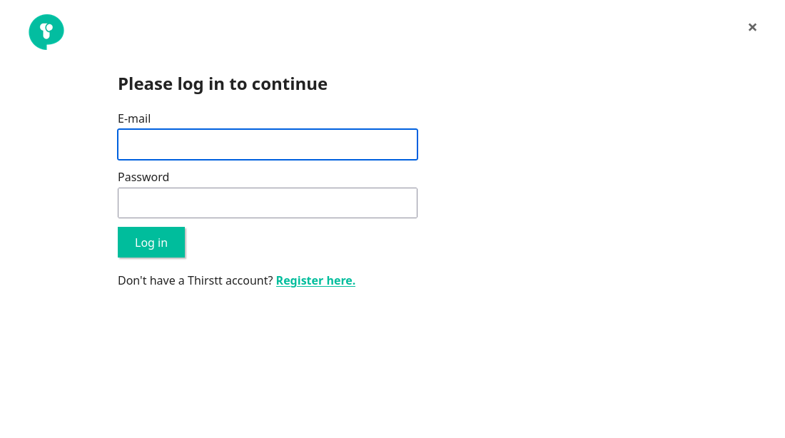
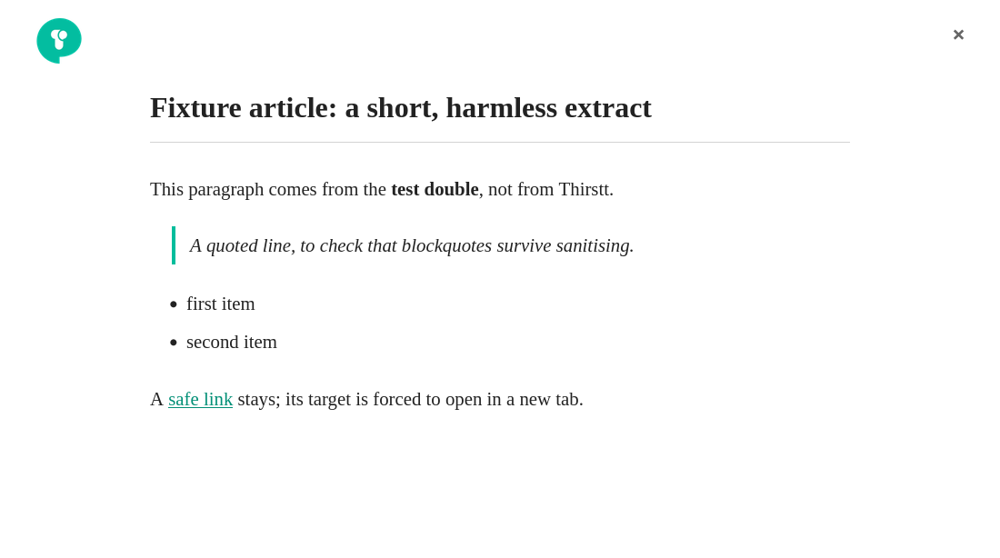

# Thirstt Firefox add-on

Opens a reading overlay for the current web page: click the Thirstt toolbar button and the page's extract from the Thirstt service is shown in a panel on top of the page (without touching the page itself). If you are not logged in, the panel shows a login form first.

This is a **Manifest V3** WebExtension for **Firefox 140+** (Android 142+). It was rebuilt from a legacy Add-on SDK package that Firefox has not been able to load since version 57.

> **Status / read this first.** The Thirstt backend (`staging.thirstt.com`) was **unreachable** while this add-on was rebuilt, so the real API contract is **unverified**. The API calls follow what the original code did (see [API assumptions](#api-assumptions)); everything has been tested only against a clearly labelled **local test double** in `tests/fixtures/`. The screenshots below come from that test double and show fixture text, not real Thirstt content.

| Login | Article |
|---|---|
|  |  |

**Not ported: Clip Text / Clip Para.** The old add-on had two buttons for these, but they only logged to the console (referencing an undefined variable) and there is no backend endpoint for them. They need a product definition from the maintainer before they can be built.

## Try it: load it in Firefox (`about:debugging`)

1. In Firefox open `about:debugging#/runtime/this-firefox`.
2. Click **Load Temporary Add-on...** and select `extension/manifest.json` (or a built `.zip`).
3. Pin the button: open the puzzle-piece **Extensions** menu in the toolbar and pin **Thirstt**.
4. Open any `http://` or `https://` page and click the button. On other pages (`about:`, `file:`, the add-ons site...) the badge shows `!` and nothing opens.

A temporary add-on is removed when Firefox restarts. Alternatively `npm run start` launches Firefox with the add-on loaded via `web-ext run` (not exercised in CI; the `about:debugging` route and the automated tests are the verified paths).

Without a reachable backend you will see "Could not reach Thirstt." Use the test double below, or point the add-on at a real API.

## The test double, and how to point the add-on at a real API

**Where the backend address lives.** One place: `extension/config.js` (`API_BASE`). The manifest's `host_permissions` must name the same host as a **hostname-only** pattern (`https://host/*`; match patterns have **no port**, and a pattern with a port is accepted by Firefox but never matches). `npm run test:unit` fails if the two drift apart. `API_BASE` must be `https://`; plain `http://` is accepted only for loopback (`127.0.0.1`, `localhost`, `[::1]`) so the test double works.

**Run against the test double** (synthetic data, no real service involved):

```bash
npm ci
node tests/fixtures/mock-server.mjs 8780            # terminal 1: the test double on http://127.0.0.1:8780
npm run build:test -- --api-base http://127.0.0.1:8780 --out build/test     # terminal 2
```

then load `build/test/manifest.json` through `about:debugging` as above. The build is named **"Thirstt (test build)"** so it can never be mistaken for the real add-on. Log in with the fake user `test-user@example.invalid` / `test-password-not-real`. See `tests/fixtures/README.md`; `tests/fixtures/extract-xss.json` is a deliberately hostile fixture used by the security tests.

**Point it at a real API**:

1. Edit `API_BASE` in `extension/config.js` to the real origin (for example `https://api.example.com`).
2. Change `host_permissions` in `extension/manifest.json` to the matching `https://api.example.com/*`.
3. Run `npm run lint && npm run test:unit`, then load the result through `about:debugging`.
4. Compare the real responses with [API assumptions](#api-assumptions), then replace the fixtures and update `tests/fixtures/mock-server.mjs` to match.

### API assumptions

Taken from the original add-on code, **not verified against the real service**:

- `GET {API_BASE}/mediaservice/fetchExtract?url=<percent-encoded page URL, without #fragment>` returns a JSON array whose first element has `title` (text) and `content` (HTML). A reply that is not that JSON (typically a login page), or HTTP 401/403, means "log in first".
- `POST {API_BASE}/login` with JSON `{"email", "password", "isJson": 1}` returns 2xx on success and sets the session cookie; 400/401/403 mean wrong credentials.
- A "Register here" link opens `{API_BASE}/register`.

## Firefox version floor: 140 (desktop) / 142 (Android)

`browser_specific_settings.gecko.strict_min_version` is **140.0** and `gecko_android.strict_min_version` is **142.0**. These are the **minimum versions that support `data_collection_permissions`**, the manifest key through which new Firefox extensions must declare what data they collect (`web-ext lint` warns if the Android floor is lower). Raising the floor further is possible; lowering it would mean dropping that declaration.

The add-on declares, honestly, that it collects: **`authenticationInfo`** (the e-mail and password typed into the login form are sent to the Thirstt API), **`browsingActivity`** and **`personallyIdentifyingInfo`** (the address of the page you open it on is sent to the Thirstt API, and you are identified by your Thirstt account). Nothing is sent anywhere until you click the toolbar button, and nothing is sent to anyone but the configured API origin.

### Permissions

| Permission | Why |
|---|---|
| `activeTab` | Inject the overlay into the page you clicked the button on (no access to other tabs). |
| `scripting` | `scripting.executeScript` for that injection. |
| `host_permissions`: the API origin only | The background page calls the API. No `<all_urls>`. |
| web-accessible resource: `panel/panel.html` only | So the overlay can frame the panel. |

## Security model

- **The overlay is an extension-origin iframe.** The content script creates a closed shadow root with an `<iframe>` of `panel/panel.html`. The article and the login form live in that frame, so page scripts can neither read what you type nor receive the backend HTML. The host page DOM gets one wrapper element; nothing else is added or changed.
- **Backend HTML never enters the page, and is sanitised anyway.** `extension/lib/sanitize.js` parses the HTML inertly (`DOMParser`) and **rebuilds** it from an allow-list (headings, paragraphs, lists, quotes, code, emphasis, `hr`, links). No attribute is copied except a vetted link `href` (**http(s) only**, with `rel="noopener noreferrer nofollow"` and `target="_blank"`). Script, style, iframe, object/embed, SVG/MathML, forms, images and the like are dropped with their content. Limits: nesting depth 64 (deeper text is kept, structure flattened) and 50,000 nodes. The title is always set as text. There is no `innerHTML`, `eval` or inline script anywhere (a unit test enforces it), and the CSP is `script-src 'self'; object-src 'none'; base-uri 'none'`.
- **All API calls are made by the background page, never by the panel.** An extension frame embedded in a web page gets its cookies *partitioned per embedding site*, so a login made on one site would be forgotten on the next. The background page uses the extension's own cookie jar, so one login works across sites. The panel talks to the background only through `runtime.sendMessage`, and the background accepts messages only from its own panel page, framed in a tab.
- **The page URL is learned from the overlay, not from the panel.** The panel page must be web-accessible, so *any* web page can frame it. The background therefore never trusts a URL from the panel's query string or a message: it asks the overlay content script (which exists only in tabs where you clicked the button) which page it is on. A hostile page that frames the panel gets no answer and no request is made. (This was a real issue in the first port; see the security PR.) Remaining risk: a hostile page can frame the login form, but cannot read what you type.
- **Network hygiene.** HTTPS-only API base (loopback exception for testing); request timeout 15 s; responses capped at 2 MiB (counted in bytes); a reply that ends on another origin after a redirect is discarded; titles capped at 500 characters; the page URL is sent percent-encoded and without its `#fragment`; requests are `no-store` with no referrer. Email and password length are bounded.
- **No logging of anything.** No `console.*` anywhere in the shipped code, so credentials and page URLs never reach a console (a unit test enforces it). The add-on stores nothing; your session cookie lives in Firefox's cookie jar for the API origin.

## Develop and test

Requires **Node 22+**.

```bash
npm ci
npm run lint            # web-ext lint (must report 0 errors, 0 warnings)
npm run test:unit       # sanitiser, API client, manifest/config consistency, "nothing logs" checks (jsdom)
npm run test:e2e        # real Firefox via Selenium + geckodriver, against the test double
npm run build           # web-ext-artifacts/thirstt-<version>.zip (only the extension/ files)
```

The e2e suite installs the add-on **temporarily in real Firefox** (Playwright cannot load WebExtensions in Firefox, hence Selenium) and checks: MV3 install with exactly the permissions above; overlay open/close/reopen; the page DOM untouched and the encoded URL sent; login wrong then right; that **one login carries over between sites**; a 21-vector XSS corpus (nothing executes, nothing dangerous reaches the DOM); and that a hostile page framing the panel can neither fetch nor log in. It needs Firefox and `geckodriver` (set `GECKODRIVER=/path/to/geckodriver` if it is not on `PATH`); the chrome-context access it uses needs geckodriver's `--allow-system-access`, which the helpers pass. If Firefox is a snap package, keep the repository in a non-hidden directory.

CI runs lint, the unit tests, the build (uploading the zip as an artifact and checking that it holds only the extension), the e2e suite on the runner's Firefox, and `npm audit` scoped to what ships (the extension has **no runtime dependencies**; advisories in `web-ext`'s own dev tooling are reported but do not ship).

## Build, sign, publish

`npm run build` produces an unsigned zip. Release Firefox only runs signed extensions, so a distributable build must be signed through addons.mozilla.org (`web-ext sign` with your own API credentials, never committed). The add-on ID `jid1-XahVBfTj5Fp3Sg@jetpack` is kept so existing installs and any existing AMO listing stay the same add-on. Whether and how it is published is a decision for the maintainers.

## Known issues

- Real API contract and real session behaviour are unverified (see the status note); real thirstt.com cookies are not shared with the add-on, which keeps its own session after you log in through its form.
- Clip Text / Clip Para are not implemented (above).
- The selenium suite does not collect the browser console; "nothing logs" is enforced statically instead.
- Firefox only; there is no Chrome build.
